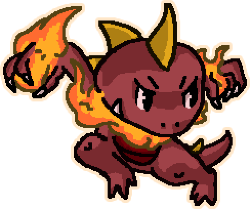

# Making characters

Each folder here is a character the game adds after the seven original characters. The game numbers them 8, 9 and so on in folder name order. The `_templates` folder holds copies of the original characters to read and copy from, and `_examples` holds finished example characters. The game ignores both.

## Quick start

The game's site has the mod maker too, so a player needs no copy of the project. Choose **Mods** on the main menu, then **Make a mod**. The site's mod maker keeps characters in that browser, and **Export character** downloads a copy to keep or share. **Play** adds the character to the Mods list in the same browser and opens the game.

In a copy of the project, start the mod maker with:

```bash
npm run characters
```

Choose **New character**, pick the original character to start from, and change what you want. **Build and play** saves the character, adds every character in this folder to the game, and opens the game. The game page reloads by itself after each build. Open `/mod-maker.html?browser` on the development server to try the site's version, which keeps characters in the browser instead of this folder.

## Example: Red Gnaw



Red Gnaw is a finished example: Gnaw recolored with angry eyebrows, new stats, reworked hitboxes and timings, and a gimmick that marks targets with Red and bursts them at three stacks. [Its tutorial](_examples/red-gnaw/README.md) makes him step by step, and shows how to add him as a mod, share him and play him online. In the mod maker, choose **New character** and pick Red Gnaw under Examples to start from him.

## How a character works

A new character is made from an original character, its template. The template decides how every move behaves: charging, projectiles, grabs, and any other scripted behavior. Your character decides how the moves look, sound and hit. Each move on the Moves tab is either the same as the template's or customized with its own numbers, hitbox, effect frames and sounds. Every check the game makes for the template character also applies to yours, so it keeps the template's built-in mechanics.

A character with no template has no scripted moves, and every move is a plain hitbox made from its data.

## The editor tabs

- **Overview**: name, template, character select text, and the gimmick script.
- **Stats**: speed, jumps, weight, hurtbox size and the other stats.
- **Animations**: one row per action the fighter plays an animation for. Paint a row's frames, upload frames, or download all of them as a zip. Hover over a frame to download it as an image or to upload an image in its place. Drag a row onto another to swap the two animations. Hold Ctrl while dropping to copy one over the other. **Recolor character** changes colors in every frame and the art at once.
- **Moves**: the hitbox drawn over the fighter (drag it to move it, drag a corner to resize it), a timeline of the fighter's frames and the effect frames, the frames the hitbox can hit on, and sounds.
- **Art**: menu and match intro images.
- **Particles**: animations a gimmick script shows, such as a mark over a fighter.
- **CPU**: how the computer player uses the character.
- **Check and build** (**Check and play** on the site): problems that stop the build, and files the character no longer uses.

**Export character** downloads a character as a zip, and **Import character** adds one from a zip. Players add the same zip to the game's page with **Mods** on the main menu, without the project, so a zip is all a player needs. A zip from the project carries the gimmick script compiled to JavaScript for that. Both mod makers export and import the same zip.

The paint editor draws at the character's own pixel size and scales the frames up to the game's image size when it saves. It keeps layers in the character's `paint` folder. Left click draws, right click picks a color, F fills under the pointer, and Shift click draws a line from the last point. Ctrl+Z undoes. Hover over a button to see its name.

## The character folder

| Path | What it holds |
| --- | --- |
| `character.json` | Everything except images and sounds. The editor writes it, and you can edit it by hand. |
| `animations/` | Fighter frames. |
| `moves/<move>/` | Effect frames: the move's visual, drawn at the hitbox. |
| `art/` | Menu and match intro images. |
| `particles/` | Particle frames for the gimmick script. |
| `sounds/` | Move sounds. |
| `paint/` | Layered paint documents. The game does not use them. |
| `gimmick.ts` or `gimmick.js` | The gimmick script, if the character has one. |

## How the game reads the data

**Animation frames.** The fighter plays the frames whose names start with its current action, such as `idle`, `run`, `jump`, `NPunch` or `E1`, in the order they appear. A frame with `NL` in its name holds until the action changes. The jump starts when the `jcharge` animation reaches a frame named `jchargeNL`. Each frame has a speed code that sets how long it shows:

| Speed | Game frames |
| --- | --- |
| 6 | 1 |
| 5 | 2 |
| 4 | 3 |
| 3 | 5 |
| 2 | 7 |
| 8 | 11 |
| 1 | 20 |
| 7 | 67 |

The game runs at 30 frames per second.

**Images.** Frame images are PNG files at twice the game's stage resolution (resolution 2), or SVG files at resolution 1. Each image has a center in image pixels that lines up with the fighter's position.

**Hitboxes.** A move's hitbox is a rectangle of the hitbox width and height. Its center sits at the offset from the fighter's position, mirrored when the fighter faces left. It hits a fighter whose hurtbox (the hurtbox width and height around that fighter's position) overlaps it. The effect frames draw at the hitbox center and do not change what it hits.

**When a hitbox can hit.** Without a window, the hitbox can hit for its whole life. With one, it can hit from the start frame up to the end frame of its life, counted from 0.

**Sounds.** The start sound plays when the hitbox appears. Each sound cue plays on a frame of the hitbox's life, and cues wait during hit pause.

## Gimmick scripts

A gimmick script runs code for one character at fixed moments. Add one from the Overview tab, and edit `gimmick.ts` in a code editor. The site's mod maker writes the script in JavaScript instead, in a box on the Overview tab (see below). It exports an object with any of these functions:

| Function | When the game calls it |
| --- | --- |
| `frame(fighter, buttons)` | Every frame, before the fighter moves, with the buttons held. |
| `move(fighter, hitbox)` | When one of the fighter's hitboxes appears, after its data loads. |
| `hit(fighter, target, hitbox)` | When one of the fighter's hitboxes connects with another fighter (shielded hits too), before knockback and damage. |
| `tick(fighter, hitbox)` | Every frame of each of the fighter's hitboxes, except during hit pause. |

`fighter` and `target` have `x`, `y`, `vx`, `vy`, `percent`, `invincibility`, `hitstun` and `comboMeter` to read and change. They also have `direction`, `state` (such as `idle` or `jump`), `action` (such as `NPunch` or `shield`), `character`, `width`, `height` (the hurtbox) and `time` (game frames since the start) to read. `slot(n)` and `setSlot(n, value)` read and change the fighter's five gimmick slots. `all()` lists every fighter in the match. `particle(name, x, y)` shows one of the character's particles, or one of the game's own such as `02_Expl`, at the fighter. `random(from, to)` returns a whole number. `hitbox` has `move` (such as `NPunch-8`), `frame`, `active`, `playSound(name)`, and `attribute(name)` and `setAttribute(name, value)` for the move data on the Moves tab. `src/game/gimmick-api.ts` documents each one.

Two rules keep online games in sync, because every player's computer runs the script and rollback replays frames:

- Keep state only in the game: the gimmick slots or the fighter's values. A variable in the script is not rewound by rollback.
- Use `fighter.random` for randomness. Never use `Math.random`, the clock, or anything from the page.

The original characters use gimmick slots 1 and 5, so a character that keeps its template's mechanics should use slots 2 to 4.

When a character is a mod on the game's page, its script runs in a sandbox. The script sees only the fighters and hitboxes the game hands it, plus a `console` for messages. It has no page, network, storage or timers, and `Math.random`, `Date.now` and `new Date()` throw there. It can't import anything, and the sandbox refuses a script that calls `eval` directly. A script that follows the rules above runs the same in the sandbox. Players turn on the script of a mod from someone else themselves, after reading it on the Mods screen. Scripts of characters built into the site from this folder run as part of the site, outside the sandbox.

This example builds heat with each hit, makes hits stronger with more heat, and lets the fighter vent heat by taunting:

```ts
import type { Gimmick } from '@characters/api';

export default {
  hit(fighter, target) {
    const heat = fighter.slot(2);
    target.percent += heat / 10;
    fighter.setSlot(2, Math.min(100, heat + 20));
  },
  frame(fighter, buttons) {
    if (buttons.taunt && fighter.slot(2) > 0) fighter.setSlot(2, fighter.slot(2) - 1);
  },
} satisfies Gimmick;
```

### Scripts on the site

The site's mod maker runs JavaScript and does not compile TypeScript. A compiler in the page would add several megabytes to download, and the script box has no type checking to gain from it. A JavaScript script is the TypeScript one without its types, so the example above works on the site without its first line and without `satisfies Gimmick`. The mod maker loads the script each time you save it, and the Check and play tab shows the error if it does not load.

The two kinds of script move between the mod makers without changes. Importing a zip from the project on the site keeps the JavaScript copy the zip carries. The project's build accepts a `gimmick.js` as it is, and its type checking skips it.

## Coming from the original project

| In the original project | Here |
| --- | --- |
| Fighter sprite costumes named `<speed>)<character>'<animation>` | Animations tab |
| Hitbox sprite costumes named `<speed>)<move>-<character>-<n>` | Effect frames on the Moves tab |
| The move data list entry | The Moves tab fields |
| The frame data list entry | When it can hit, on the Moves tab |
| The cannot-move, unique animation, shield breaking, velocity limit, freeze and hit sound lists | The Moves tab fields |
| The character data list entry | Stats tab |
| Menu and intro costumes in each menu sprite | Art tab |
| Character names, descriptions and CPU lists | Overview and CPU tabs |
| Move scripts that check the attack name | The template's scripts, or a gimmick script |

## Without the editor

`npm run characters:build` checks and builds every character from its `character.json`. Errors name the character and the problem. `npm run characters:export` writes the original characters into `_templates` again.

Players in an online game need the same characters. The game compares builds when players join a room, so builds with different characters never share one. The Red Gnaw tutorial shows how players with the same characters meet online, and how to publish characters in a fork.
